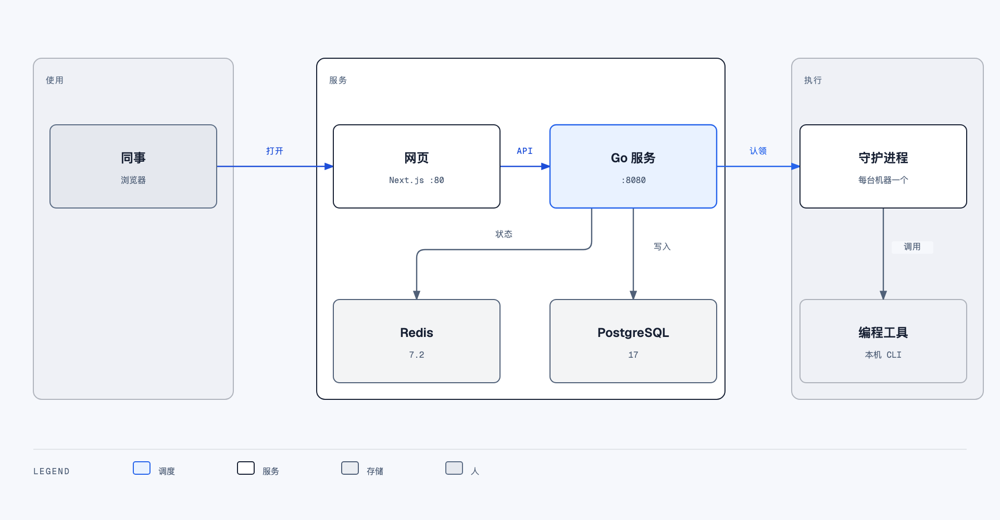
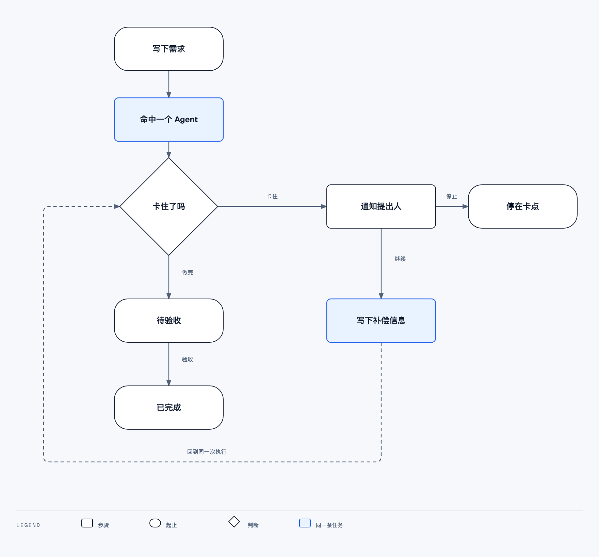

# 跨期决定

## 产品

系统做的是：在网页上按项目收集需求，精确分给这个项目里负责该模块的 Agent，监督它做完。项目就是组织，必须有一名成员负责人，成员由负责人或工作区所有者、管理员拉进来。不在项目里的人看不到这个项目，也不能提交。同事打开聊天，写下几句话就发送。他不选项目，不选模块，也不看是谁在做。服务里的一次模型调用把这几句话拆成有顺序的开发任务，并选定一个模块承接。整次发送只生成一条需求，只交给该行主责，只开一个分支，只部署一次。不注册内部 Agent，也不把同一句话分给多个 Agent 各自拉分支、各自部署。模块事先绑好一个主责 Agent，可以再绑一个备责。提出人只看见这件事情到了哪一步：等待处理、正在做、做到、还剩、等你补充、待验收、已完成。对不上任何一行时不创建需求，请他再补一句。发送之后不再改判。主责在线就开始做。主责不在线，备责在线且已指定时才交给备责。两个都不在线就不入队。提出人只看见「还没开始」，维护通知发给 Agent 所有者和项目负责人。系统不再改判到没被选中的模块。

任务属于公司，不属于某一次打开的窗口。浏览器关掉之后，机器上的执行还在。失败或卡住时系统自己恢复：先在同一模块的主责上重试或按已有信息继续，再交给这个模块已指定的备责。不把需求改派到别的模块。注册单位是名单上的一个 Agent 和它绑定的那台机器。提出人 15 分钟内点了继续或停止，以他的决定为准。点了停止就留在卡点，不再拉起。卡点不记成失败。

一期只通知提出人本人。卡片里的内容都取自网页上已经记下的这条需求。做到待验收之前，白天大约每半小时、夜里大约每两小时告诉他做到哪了、还剩多少，然后自己继续。

## 一期范围

一期是网页，也能从飞书工作台打开同一套聊天。同事日常在聊天里提交需求、看进行到哪、在卡点上选择继续或停止。管理从聊天上的一个开关进去。个人管理自己的定时需求和自己的 Agent。所有者、管理员和项目负责人维护模块分工、项目成员和测试环境。

飞书不设一个可以私聊或 @ 的机器人。24 小时执行在 Go 服务和执行机器上，不靠飞书在线。需要叫醒人时，用飞书应用身份发卡片。卡片打开飞书里的同一套聊天。在卡片上直接继续或停止仍不在一期。

一期不做：桌面端、手机端、同事电脑上的终端、飞书机器人收需求、在卡片上提交继续或停止、换成 MySQL、去掉 TanStack Query、对象存储。

## 页面

所有人一进来都是聊天，包括所有者和管理员。

1. 对话是自己发出的需求，以及系统回的状态、卡点、结果
2. 输入条只有要说的话，和一个发送按钮。发送后对话里只有进度，不出现执行人
3. 右上角一个开关。成员切到个人管理：自己的定时需求、自己的 Agent、所属项目的进度。调好 Agent 的人在这里改身份，并进入现有运行配置做调试。项目负责人切到管理后先看见能力总览，在一行里换主责、备责、加模块、拉人
4. 左上角是标志，点开使用说明。头像在标志旁边，下拉里是当前登录的人和退出

状态用词：等待处理、正在做、等你补充、已经停住、待验收、已完成。卡点在这组对话里展开，三句：已经做了什么、缺什么、不补会怎样。继续是主按钮，停止是次按钮。

颜色、字体、按钮和间距仍是同一套。开关用 200ms 过渡；系统要求减少动态时直接换过去。管理比聊天密，用的还是这些。

## 角色

工作区角色和 Agent 的使用范围是两套。

| 事项 | 谁可以 |
| --- | --- |
| 创建工作区 | 创建者成为所有者 |
| 邀请管理员、成员，提升所有者 | 所有者 |
| 删除工作区 | 所有者，且至少保留一名所有者 |
| 改 Agent 的说明、技能、运行配置 | Agent 所有者、工作区所有者、管理员 |
| 改谁可以向这个 Agent 派任务 | 只有 Agent 所有者 |
| 提交和看见需求 | 该项目的成员和负责人。所有者、管理员未被拉入时看不见需求 |
| 指定模块由谁做 | 项目负责人、工作区所有者、管理员 |

模块分工只有负责人、所有者、管理员能改。Agent 所有者登记自己的 Agent 并写清负责什么，不能自己把 Agent 挂进别人的模块。每人看见什么、能点什么，见一期设计第 18 节。使用说明从左上角标志进入，不占菜单。登录信息在头像的下拉里。

## 技术

控制面沿用现在的 Go 服务和 PostgreSQL。SQL 使用 `jsonb`、`uuid`、`RETURNING`、`ON CONFLICT`、`gen_random_uuid`。不迁 MySQL。

TanStack Query 只在浏览器里记住当前页的接口结果，没有独立服务。Redis 必须配置，用于多实例实时转发和短时状态，不存放任务正文。

长连接按执行机器和打开的页面计算，不按 Agent 个数。并发上限在执行：守护进程默认同时 20 个运行，单个 Agent 默认 6 个。一次运行不换机器。

| 组件 | 版本 |
| --- | --- |
| Node.js | 22 LTS |
| pnpm | 10.28.2 |
| Next.js | 16.4.5 |
| React | 19.2.3 |
| TypeScript | 6.0.2 |
| TanStack Query | 5.96.2 |
| Zustand | 5.0.0 |
| zod | 4.1.5 |
| Tailwind CSS | 4 |
| Go | 1.26.9 |
| Chi | 5.3.2 |
| pgx | 5.11.0 |
| sqlc | 1.31.1 |
| gorilla/websocket | 1.5.3 |
| go-redis | 9.22.0 |
| golang-jwt | 5.3.1 |
| PostgreSQL | 17 |
| Redis | 7.2 |

## 风格

单列、留白、一个主按钮。字体用网页已有的 Inter 和中日韩回退。字号用 `packages/ui` 的 `--text-*`。

| 用途 | 值 |
| --- | --- |
| 主按钮、链接 | `#2563EB` |
| 页面背景 | `#F8FAFC` |
| 正文 | `#1E293B` |
| 正文大小 | 16px，行高 1.5 |
| 间距 | 8、16、24、32 |
| 悬停和状态过渡 | 200ms |
| 按下反馈 | 100ms 内出现 |
| 可点区域 | 至少 44px，相邻间隔至少 8px |
| 弹层遮罩 | 约 50% 黑 |

主按钮不用橙色。状态同时用文字和颜色。图标用 `@multica/ui/icons`。保留键盘焦点环。系统打开「减少动态效果」时，过渡改为直接切换。断点按 375、768、1024、1440 检查。桌面上内容限制在阅读宽度内。

## 部署

每个可发布进程一个 `docker/` 目录。镜像外构建，镜像里只拷贝产物。

| 进程 | 应用目录 | 端口 |
| --- | --- | --- |
| 网页 | `/dianyi/app/agent-web` | 80 |
| Go 服务 | `/dianyi/app/agent-api` | 8080 |

`PROFILE` 默认 `test-ali`，否则 `prod-ali`。配置由发布系统注入环境变量。一期不用 Apollo。必填 `DATABASE_URL`、`REDIS_URL`、登录密钥、网页对外地址。PostgreSQL 和 Redis 在容器外。守护进程装在执行机器上，不进这两个容器。

镜像仓库是 `172.30.10.185:15000`。网页用其中的 Node 22 运行镜像，Go 服务用其中的 Go 运行镜像。网页不使用 `common/nginx:1.18`，Go 服务不使用 `cd-build/jdk21:v1`。

代码里没有在线人数上限。200 个浏览器同时看页面，一台 Go 服务加 PostgreSQL 17 和 Redis 7.2 足够。约束是同时在跑的编程任务数量。
