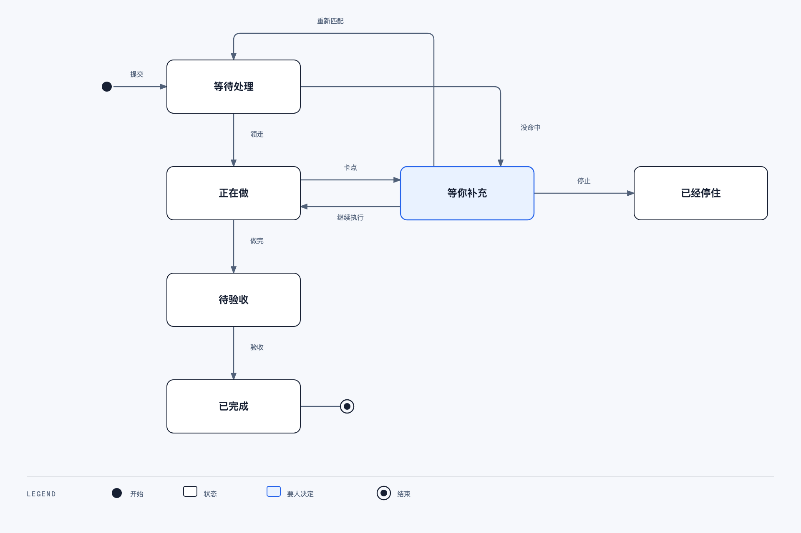
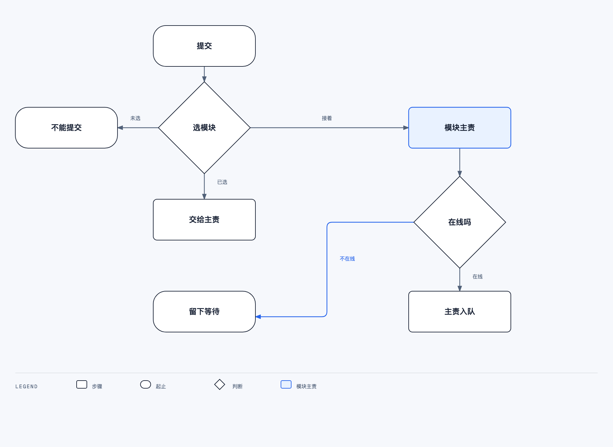
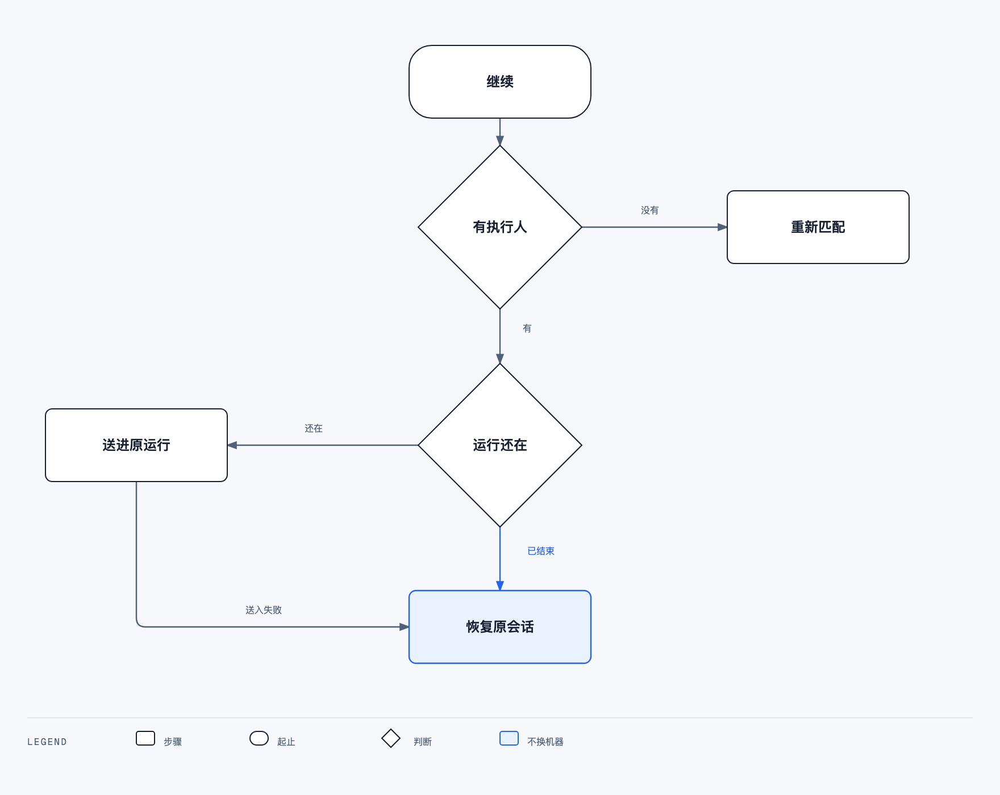

# 一期详细设计

一期交付同事用的收口页、管理员用的命中名单，以及「提交 → 命中 → 执行 → 卡点 → 继续或停止 → 待验收」这一条链路。技术栈、风格和部署约定见 [概要](../overview.md)。

## 1. 和现有代码的关系

收口里的一条需求就是一条现有的 `issue`。执行仍然进 `agent_task_queue`，由已注册机器上的守护进程领取，调用本机编程工具。项目用现有 `project`。Agent、运行时、使用范围用现有 `agent`、`agent_runtime`、`agent_invocation_target`。

现有小组不能承担命中。`squad` 被指派时只唤醒组长；组员要等组长在正文里点名才会跑。一期命中不走小组，也不在需求正文里写 `@`。

`task_supplement` 是给一次还在跑的运行追加一句人写的话。运行已经结束时，补充会被标成 `turn_ended`，到不了 Agent。继续要分两种情况，见第 7 节。

一期不新增 issue 状态。内置状态 `todo`、`in_progress`、`in_review`、`done`、`blocked`、`cancelled` 保持原样。页面上的中文状态由服务端算出来。

旧看板 `/{slug}/issues` 一期保留，入口不放在同事页上。收口创建的 issue 仍是普通 issue，打开旧看板也能看到。一期不从看板里隐藏它们。

## 2. 同事页

路由：`/{workspaceSlug}/intake`。

工作区首页对成员打开时进入这一页。实现落在：

- 路由只做组装：`apps/web/app/[workspaceSlug]/(dashboard)/intake/page.tsx`
- 页面在 `packages/views/intake/`
- 请求、schema、Query hook 在 `packages/core/`
- 路径加到 `packages/core/paths/paths.ts`

所有人打开这一页，包括所有者和管理员，先进入聊天。谁能看见什么，见第 18 节。

顶栏从左到右：标志、头像、模式开关。标志只是一个标记，点它打开使用说明，说明盖在当前内容上，关掉回到刚才的聊天或管理。头像显示当前登录的人，下拉里是名字、所在工作区和「退出」。不另做个人资料页。

模式开关始终在顶栏。成员切到个人管理，再点一次回到聊天。所有者和管理员切到管理，内容比个人更多，再点一次也回到聊天。切换时主区域用 200ms 过渡让开；系统要求减少动态效果时直接更换。颜色、字号、按钮仍用收口这一套，不另做一套视觉。

聊天区域：

1. 对话只包含当前用户自己的收口需求，按时间从早到晚。一次发送是一组气泡：自己写下的那几句话，以及系统随后写回的状态、做到哪了、还剩多少、卡点、结果。不写执行人，不写模块，不写机器。
2. 底部是输入条，只有文本。可以是几句口语。去掉首尾空白，空内容不发送。不选项目，不选模块，不选 Agent。开始时间可空，不填表示现在开始；填写的是浏览器本地时间，提交时带时区偏移。没有可提交的项目时不能发送，写「还没有可选项目」。对不上任何模块时不创建需求，原文留在输入条，上方写「没对上，请再补一句」。
3. 一个发送按钮。请求未返回前按钮不可用。失败写在输入条上方，并有「重试」。重试使用同一次 `client_request_id`。
4. 发送调用 `POST /api/intake/requests`。服务在这次请求里选定一个模块并创建一条需求。聊天里是一组气泡：原文、状态、做到、还剩。不写执行人。一次发送只有一条进度。
5. 本人这条需求处于「等你补充」时，气泡里展开三句，继续是主按钮，停止是次按钮。待验收时，提出人、所有者、管理员在这组气泡里看到「验收」。

个人管理里三块，仍是现在的列表，不做成第二套聊天：

- 定时执行：只列出当前用户创建的、还没到点的需求。到点触发一次，到点后从这里消失，回到聊天。不提供每天、每周重复。空列表写「还没有要到点执行的需求」。可以取消，规则与第 4 节相同。
- 我的 Agent：只列出当前用户拥有的 Agent。登记走这一页的短表，见第 5 节。每行显示名称、负责什么、不接什么、本机或云上、是否在线、正在做几条、被哪些项目的哪个模块用作主责或备责。行内可以改负责什么和不接什么。深度调试不在这张短表里，行上有「调试」，打开现有的 Agent 运行配置，改说明、技能和模型。那是这个 Agent 被调好的地方。
- 全部需求：只含自己所属的项目。按项目分成组。成员看见的每行是原文、状态、已执行时长、最新的做到和还剩。不写执行人。本人创建的、且还在 15 分钟决定时限内的卡点可以继续或停止。其他人的卡点只展示三句。负责人、所有者、管理员在管理里才能看见执行人。

前端、测试等成员不管理 Agent，也不看是谁在做。他们写下几句话，系统在所属项目里找到对应模块并执行。他们只看这件事情到了哪一步。

项目负责人、所有者、管理员的管理第一屏是能力总览，按产品分组。每一行是一个模块：边界、主责和备责的名字、是否在线、正在做几条。换主责或备责是两个下拉框，只列出已经写过「负责什么」的 Agent。加一行就是填写产品、模块、边界并指定主责。拉人进项目在同一屏。测试环境地址在这屏下面。普通成员看不见这屏。发送时由服务在所属项目的模块表里直接分发，成员看不到这张表。

使用说明与聊天、管理共用收口的背景、字号和按钮。文案按聊天来写：写下几句话就发送。系统自己找到人做。你只看做到哪了、还剩多少，不用回复，也不需要知道是谁在做。卡住时先通知你，15 分钟没有决定就按已有信息继续。定时在个人管理里看。负责人、所有者和管理员的说明多一节能力总览。普通成员看不到这一节。

深链：`/{workspaceSlug}/intake/{issueId}` 打开聊天并滚到这组气泡。浏览器后退回到进入深链之前的位置。

输入草稿只放在组件状态里。刷新后草稿消失。不为此新增 Zustand store。当前模式记在会话里，刷新后仍回到聊天。列表数据放在 TanStack Query，key 带 `wsId`。聊天用 `['intake', wsId, 'mine']`，全部需求用 `['intake', wsId]`，定时执行用 `['intake-scheduled', wsId]`。

## 3. 人看到的状态

`GET /api/intake/requests` 的每一行带服务端算好的 `display_status`。页面不自己拼状态。

| display_status | 条件 |
| --- | --- |
| 等你补充 | 该 issue 有一条 `state = open` 的卡点 |
| 已经停住 | 最近一条卡点的 `state = stopped` |
| 待验收 | issue 状态是 `in_review`，且没有未关闭卡点 |
| 已完成 | issue 状态是 `done` |
| 正在做 | 该 issue 有 `queued`、`dispatched` 或 `running` 的执行任务，且没有未关闭卡点 |
| 等待处理 | 以上都不是。包括还没命中、命中后机器还没领走 |

`cancelled` 不出现在默认列表里。



提出人这边不出现执行人名字。还没开始时只写「等待处理」。已经指定执行人但机器离线时，提出人仍看到「等待处理」，行内写「还没开始，恢复后可以继续」。状态不入队，也不变成卡点。提出人看到「继续」。所有者、管理员和项目负责人在管理里看到执行人名字和「继续执行」。

约定的开始时间还没到，并且执行 Agent 还没有自己的执行任务时，状态保持等待处理。分发在提交的同一次请求里完成，不产生执行任务。到点时命中的机器不在线，不入队，不换人，按上面发维护提示。正在自动重试或正在换单位时，状态保持正在做，行内写「正在重试」或「正在换注册单位」。

谁在执行由服务端在列表项的 `run` 里给出，页面不自己挑任务。`run` 只取执行 Agent 当前未结束的 `queued`、`dispatched` 或 `running`。没有则 `run` 为空。

提出人的聊天和进度只写步骤，不写名字：

| run.status | 提出人看见 |
| --- | --- |
| `running`，且有 `started_at` | 「正在做 · 已执行 {时长}」 |
| `dispatched`，还没有 `started_at` | 「正在做」 |
| `queued` | 「等待处理」 |

管理页才在同一行后面写执行人名字。时长从 `started_at` 算到当前时刻。不足 1 分钟写「不到 1 分钟」，否则写到分钟，满小时再写小时。页面用返回的 `started_at` 自己刷新这句话，不为此轮询。有未关闭卡点时不展示这句时长，等待人决定的时间不算进已执行。

执行过程中两小时没有新消息时，守护进程按现有空闲看门狗结束这次运行，原因 `idle_watchdog`。这次运行的时长停在结束时刻。这次结束不写成收口卡点，也不让需求停到第二天。按第 15 节自动重试；预算用完之后才回到等待处理，行内写「执行没有进展」。提出人、所有者、管理员可以点「继续」。

## 4. 提交

发送的几句话要先拆成开发任务，再交给一个 Agent 做完。这一步不注册内部 Agent。它是服务进程里的一次模型调用，走现有 `server/pkg/llm`，不新接一套模型，也不先让人确认。

模型看到的只有调用者所属项目里、已经绑好主责的模块：`module_id`、产品、模块、边界，加上用户原文。不交 Agent 名字，不交他未加入的项目。模型返回一个承接 `module_id`，和按顺序排列的 `tasks`。每条 `task` 只写这一件事要开发什么。服务只接受这个 `module_id` 属于这些项目、且该模块已有主责。`tasks` 去空白后至少一条。否则、没配 `MULTICA_LLM_API_KEY` 和 `MULTICA_LLM_BASE_URL`、或调用失败时，返回 422，`code = intake_split_empty`，不创建 issue。页面把原文留在输入条，写「没对上，请再补一句」。

然后只创建一条需求、一次入队。描述是这份任务清单，并写明：在同一个分支上按顺序做完，只部署一次。其他模块的 Agent 不收到运行，也不另开分支、不另部署。发送之后不再拆，也不改派到别的模块。

`POST /api/intake/requests`

```json
{
  "body": "需求原文",
  "client_request_id": "uuid",
  "start_at": "2026-11-11T01:00:00+08:00"
}
```

`start_at` 可省略。省略、或早于等于服务端当前时间，表示现在开始。有值时必须是带时区偏移的绝对时间，晚于当前时间，并且在一年以内。不符合时返回 400，不创建 issue。

先在事务外拆分。命中之后，创建 issue 和指定执行人在一个事务里完成，入队在事务提交之后：

1. 调用者是该工作区成员。收集他作为成员或负责人、且项目有成员负责人的模块。一个都没有则 422，`code = intake_project_lead_missing`，不创建 issue。
2. 用上面的模块表和原文调用拆分，得到一个 `module_id` 和有序 `tasks`。`module_id` 必须属于这些项目且已有主责，`tasks` 至少一条。否则 422，`code = intake_split_empty`，不创建 issue。
3. 只创建一条 `issue` 和一条 `intake_request`。标题是第一条 `task` 压成一行后的前 80 个字。描述是完整任务清单，末尾写「在同一个分支上按顺序做完，只部署一次。」原文记在 `intake_request.source_body`。`project_id`、`module_id` 记下承接的项目和模块。`creator_type = member`，`creator_id` 为当前用户，状态 `todo`。同一用户用同一个 `client_request_id` 再次提交时，返回已创建的这一条，不重新拆分。
4. assignee 写成这一行的主责 Agent。不给其他模块创建运行。`start_at` 还在将来，就创建一条现有的一次性唤醒，不入队。主责心跳在线则入队。主责不在线、且备责已指定并在线，则 assignee 改为备责并入队，需求上写明交给备责的原因。备责接着同一份任务清单，仍是一个分支、一次部署。主责和备责都不在线：保留主责为 assignee，不入队，发「需要维护」。

唤醒使用现有 `issue_wakeup`：`kind = at`，`mode = once`，`at` 为 `start_at`，`agent_id` 为已命中的执行 Agent，`instruction` 为需求全文，创建者是提出人。不新做定时器。到点后由现有唤醒检查入队，误差在现有检查间隔内。唤醒触发的就是这个执行 Agent 的一次普通运行，仍绑定它当时的运行时。

命中完成时若 `start_at` 已经到了或过了，不再创建唤醒，直接入队。到点前，提出人、所有者、管理员可以取消：`POST /api/intake/requests/{issueId}/cancel`。取消关闭这条唤醒，不入队，issue 改为 `cancelled`，默认列表不再显示。已经入队或正在做的任务不走这个取消，停止仍走第 8 节。

入队失败时 issue 保留，状态保持等待处理，接口返回 201 并带 `enqueue_error`。页面把该行显示为等待处理，并在行内给提出人一个「重试」。重试调用 `POST /api/intake/requests/{issueId}/match`，不新建 issue。

## 5. 身份、项目和命中

Agent 来自外部。注册时必须写下身份，否则不能进任何项目的名单，也不能被命中。身份写在现有 `agent` 上，新增两列：

| 列 | 说明 |
| --- | --- |
| intake_can | 负责什么。必填，一句 |
| intake_cannot | 不接什么。可空，一句 |

名称、本机或云上沿用现有 `name`、`runtime_mode`。所有者是登记的人。技能、模型和长说明仍留在现有运行配置页，短表不收集。

短表在「我的 Agent」里，按钮「登记」。`POST /api/intake/agents`，body 是 `{ "name", "can", "cannot", "runtime_mode" }`。`can` 去空白后为空则 400，不创建。任何工作区成员都可以登记，创建后自己是所有者。已有 Agent 补身份用 `PATCH /api/intake/agents/{agentId}`，仅这四项。Agent 所有者、工作区所有者、管理员可以改。`can` 不能改成空。

项目就是组织，用现有 `project`。一名成员负责人用现有的 `lead_type = member` 和 `lead_id`。负责人由工作区所有者或管理员指定。没有成员负责人的项目不能提交，返回 422，`code = intake_project_lead_missing`。负责人能看本项目的全部需求，对本项目里等待维护的需求点继续执行，并收到本项目 Agent 下线的卡片。负责人不能改别人的 Agent 使用范围，也不能提升工作区所有者。

谁能提交、谁能看见，由项目成员决定。新表 `intake_project_member`：`workspace_id`、`project_id`、`user_id`，唯一 `(workspace_id, project_id, user_id)`。负责人算成员，不必再写一行。所有者、管理员和该项目负责人可以把人拉进来。不在其中的人看不到该项目的需求，下拉框里也没有这个项目。工作区所有者和管理者未被拉入时，同样看不见需求；他们仍可维护模块和成员。

谁来做，在需求进来之前写在模块上。模型只从这些行里挑出要做的模块，不指定 Agent。新表 `intake_module`：

| 列 | 说明 |
| --- | --- |
| product | 产品名，非空 |
| module | 模块名，非空 |
| scope | 这个模块接什么、不接什么，非空 |
| agent_id | 主责，恰好一个，必须已填写 `intake_can` |
| backup_agent_id | 备责，可空。有值时必须是另一个已填写 `intake_can` 的 Agent |

同一项目里，产品和模块的组合唯一。主责和备责不能是同一个 Agent。保存时两者都属于该工作区。重复组合返回 422。`intake_can` 为空则 422，`code = intake_identity_missing`。

谁来写这张表：该项目负责人、工作区所有者、管理员。`PUT /api/intake/modules` 按项目整体替换。Agent 所有者只能登记身份，不能把自己挂进模块。

发送时人只提交原文。模型把它拆成有顺序的任务清单，并选定一个模块。执行人是该行主责。其他模块不收到运行。提出人的气泡仍是原文和一条进度，不看执行人，也不看任务清单。入队前只看这一行的在线：

1. 主责在线：入队给主责。已满也入队，只是排队。
2. 主责不在线，备责已指定且在线：assignee 改为备责，入队，需求上写明主责不在线所以交给备责。
3. 主责不在线，且没有在线的备责：assignee 保持主责，不入队，发「需要维护」。

执行仍由外部登记的 Agent 在自己的机器上完成。执行用的是该 Agent 自己的模型。收口这个客户端只在发送时把原文对到模块行。

「继续执行」调用 `POST /api/intake/requests/{issueId}/resume`。提出人、该项目负责人、工作区所有者、管理员可以调用。服务按第 5 节再看一遍主责和备责：能入队就入队；仍都不在线则不入队，再发一张「需要维护」。维护指把主责或备责的机器恢复到心跳在线，做完后再点这一下。

拨测就是现有守护进程心跳，加上每 30 秒一次的运行时清扫。平台主动核对心跳还在不在。心跳间隔 15 秒。连续 150 秒没有心跳，清扫把这台运行时标成离线，这一轮就发告警。少一次心跳不告警。机器上不另装探针。

只关心写过「负责什么」的 Agent。从未上过线的，在「我的 Agent」里显示不在线，不重复告警。从在线变成离线的这一次才发。同一台机器上同一次下线，每位所有者只收一张卡片，列出他在这台机器上的 Agent。这些 Agent 所在项目的负责人也收一张，列出本项目受影响的 Agent；和所有者是同一人时不重复发。已经有未完成需求指定到这些 Agent 时，那些需求的提出人各收一张「还没开始」；卡片不写执行人和机器。同一次下线里，提出人已经收到过这张的需求不重复发。恢复心跳后，所有者和负责人收到一张「已恢复」。还停在等待处理的需求，向提出人再发一张「可以继续」，也不写执行人，不自动入队。下一次再从在线掉到离线，才重新告警。



现有 `POST /api/issues/{id}/squad-evaluated` 不参与这条链路。

## 6. 执行

被选中的 Agent 沿用现有领取：守护进程通过 WebSocket `tasks.claim` 拿走 `agent_task_queue` 里的任务，失败时走现有 HTTP 领取。任务上的 `runtime_id` 在入队时按该 Agent 当前绑定的运行时写上。一次运行不换机器，也不换 Agent。

Agent 的现有说明、技能、运行配置不变。入队时追加两段只读上下文，不写回 Agent 配置：

- 该项目命中名单上这个 Agent 的职责
- 该项目 `resource_type = test_environment` 的 `project_resource`。`resource_ref` 约定为 `{ "url": "https://..." }`。没有这条资源时，上下文写「该项目还没有测试环境」，运行仍可进行。做完后页面仍可进入待验收，行内显示「还没有测试环境」。

测试环境不新建表，用现有 `POST /api/projects/{id}/resources`。管理页上有一个 URL 输入框，保存时写成或更新这条资源。

Agent 把 issue 状态改为 `in_review` 时，页面变为待验收。这是现有状态写入。一期不另做部署流水线。一次需求只由这一个 Agent 部署一次，地址用该项目的测试环境。部署动作写在它的职责里，由它在这次运行中完成。

## 7. 卡点

执行中的 Agent 发现缺信息、不能继续时，调用：

`POST /api/issues/{id}/intake-blocker`

```json
{
  "task_id": "当前运行的 uuid",
  "done": "已经做了什么",
  "missing": "缺什么",
  "consequence": "不补会怎样"
}
```

三句都不能为空。调用者必须是该 issue 当前 assignee 对应的运行时，且 `task_id` 属于这个 issue、这个 Agent。成功后：

- 插入一条 `intake_blocker`，`state = open`
- issue 状态改为 `blocked`
- 不把 `agent_task_queue` 标成 `failed`
- 不新建 issue

同一 issue 已有未关闭卡点时返回 409，`code = intake_blocker_open`。

通知沿用现有收件箱，收件人是提出人。收口页自己展示卡点，不依赖同事去打开收件箱。实时更新沿用现有 issue 与 task 的 WebSocket 事件：事件到达后让 Query key `['intake', wsId]` 失效。不把服务端载荷写进 Zustand。

Agent 若只把状态改成 `blocked`、没有调用这个接口，页面没有三句说明，不能继续或停止。管理页不补救这种写法。平台给执行 Agent 的任务说明里写明：要停下来问人，必须调用这个接口，并且三句都要写。

## 8. 继续和停止

两个接口都只有提出人、所有者、管理员能调用。其他人返回 403。

`POST /api/intake/requests/{issueId}/continue`

```json
{ "body": "补偿说明", "client_request_id": "uuid" }
```

补偿说明去空白后不能为空。没有 `state = open` 的卡点时返回 409。唯一的例外是第 3 节的「执行没有进展」：这时 body 可空，不写评论，不新建卡点，按下面「运行已经结束，assignee 是执行 Agent」入队。

处理：

1. 把补偿说明写成该 issue 的一条普通评论，作者是当前用户。
2. 把卡点改为 `continued`，记下这条评论。
3. issue 状态改回 `todo`。
4. 按当时的 assignee 决定怎么接着跑。

接着跑的规则：

| 当时的情况 | 动作 |
| --- | --- |
| 卡点上的 `task_id` 仍是 `running`，且该运行声明支持补充 | 调用现有 `CreateTaskSupplement`，把这句评论送进同一次运行 |
| 运行已经结束，assignee 是执行 Agent | `EnqueueTaskForIssue`，不使用 `forceFreshSession`。同一 Agent、同一 issue 会恢复已有会话。新的队列行仍落在该 Agent 绑定的运行时上，不重新挑选机器 |
| 还没有 assignee | 按该需求记下的模块，再走第 5 节的主责和备责。补偿说明已经在描述下方的评论里 |



补充送入失败，且运行已经结束：按第二行再入队一次。入队也失败：卡点保持 `continued`，issue 回到 `todo`，接口在 body 里带 `enqueue_error`，行内提供重试。不把状态打回 `blocked`，避免提出人看到自己已经继续、页面却仍要求他再做一次决定。

`POST /api/intake/requests/{issueId}/stop`

没有请求体。卡点改为 `stopped`。若 `task_id` 仍在跑，取消该次运行，用现有取消任务的路径。不入队。issue 保持 `blocked`。页面状态为已经停住。停止后没有继续按钮。

停止和继续都先等服务端成功，再改列表。不做乐观删除。

## 9. 验收

`POST /api/intake/requests/{issueId}/accept`

issue 当前状态必须是 `in_review`，且没有未关闭卡点。提出人、所有者、管理员可以调用。成功后状态改为 `done`。不入队。

## 10. 数据

新表不加外键。关系在事务里由应用检查：项目、Agent、issue、task 必须属于同一个 `workspace_id`。索引单独迁移，使用 `CREATE UNIQUE INDEX CONCURRENTLY`。

`intake_module`

| 列 | 说明 |
| --- | --- |
| id | uuid，默认 `gen_random_uuid()` |
| workspace_id | 工作区 |
| project_id | 项目 |
| product | 产品名 |
| module | 模块名 |
| scope | 职责边界 |
| agent_id | 主责 |
| backup_agent_id | 备责，可空 |
| position | 同一项目内的顺序，从 0 起 |
| created_at / updated_at | |

唯一索引 `(workspace_id, project_id, product, module)`。查询索引 `(workspace_id, project_id, position)`。

`intake_project_member` 的列见第 5 节。索引 `(workspace_id, project_id, user_id)` 唯一，另有 `(workspace_id, user_id)` 供下拉框列出此人的项目。

`intake_request`

| 列 | 说明 |
| --- | --- |
| id | uuid |
| workspace_id | |
| issue_id | 对应的那条 issue，工作区内唯一 |
| project_id | 提交时的项目 |
| module_id | 提交时的模块 |
| requester_id | 提出人的 user id |
| client_request_id | 提交幂等 |
| source_body | 用户原文。issue 描述是拆出来的那条任务 |
| start_at | 约定的开始时间，可空。空表示提交后即可入队 |
| last_user_notice_at | 上一次写给提出人的进展或卡片时间，可空 |
| created_at | |

唯一索引 `(workspace_id, requester_id, client_request_id)` 和 `(workspace_id, issue_id)`。一次发送只对应一条需求。列表按 `created_at desc, id desc` 查，索引 `(workspace_id, created_at desc, id desc)`。「定时执行」按 `start_at asc, id asc` 查，部分索引 `(workspace_id, requester_id, start_at, id)`，条件 `start_at IS NOT NULL`。

`intake_blocker`

| 列 | 说明 |
| --- | --- |
| id | uuid |
| workspace_id | |
| issue_id | |
| task_id | 报告卡点的那次运行；命中失败时为空 |
| agent_id | 报告的 Agent；命中失败时为空 |
| done_text / missing_text / consequence_text | 三句，非空 |
| state | `open`、`continued`、`stopped` |
| decision_comment_id | 继续时写下的评论 |
| decided_by | 做决定的 user id |
| created_at / decided_at | |

部分唯一索引：`issue_id` where `state = 'open'`。同一条需求同时只有一个未关闭卡点。

不新增分发用的 Agent，也不在页面上保存模型名或密钥。拆分沿用部署环境里的 `MULTICA_LLM_API_KEY` 和 `MULTICA_LLM_BASE_URL`。命中的模块行才是分发依据。

## 11. 接口

全部走现有登录态和 `X-Workspace-ID`。响应经 `packages/core/api/schema.ts` 的 zod schema 和 `parseWithFallback`。每个新接口补一条畸形响应测试。

| 方法 | 路径 | 谁可以 |
| --- | --- | --- |
| GET | `/api/intake/requests` | 只返回调用者有权看见的项目。查询参数 `project_id` 可选 |
| GET | `/api/intake/scheduled` | 工作区成员。只返回当前用户创建的、`start_at` 仍在将来、执行 Agent 尚未入队的需求 |
| GET | `/api/intake/agents` | 工作区成员。只返回当前用户拥有的 Agent，含 `can`、`cannot`、`runtime_mode`、是否在线 |
| POST | `/api/intake/agents` | 工作区成员。登记自己的 Agent，自己成为所有者 |
| PATCH | `/api/intake/agents/{agentId}` | 该 Agent 所有者、工作区所有者、管理员。只改名称、负责什么、不接什么、本机或云上 |
| POST | `/api/intake/requests` | 工作区成员。服务只在他所属的项目里拆分并创建 |
| POST | `/api/intake/requests/{issueId}/match` | 提出人、所有者、管理员 |
| POST | `/api/intake/requests/{issueId}/continue` | 提出人、所有者、管理员 |
| POST | `/api/intake/requests/{issueId}/stop` | 提出人、所有者、管理员 |
| POST | `/api/intake/requests/{issueId}/accept` | 提出人、所有者、管理员 |
| POST | `/api/intake/requests/{issueId}/cancel` | 提出人、所有者、管理员。仅当执行 Agent 尚未入队 |
| GET | `/api/intake/modules?project_id=` | 该项目成员只读。负责人、所有者、管理员可写 |
| PUT | `/api/intake/modules` | 该项目负责人、所有者、管理员。body：`project_id` 加 `modules: [{product, module, scope, agent_id, backup_agent_id, position}]` |
| PUT | `/api/intake/projects/{projectId}/members` | 该项目负责人、所有者、管理员。body：`{ "user_ids": [] }`，替换除负责人以外的成员 |
| POST | `/api/issues/{id}/intake-blocker` | 该 issue 当前执行运行时 |

列表项字段：`issue_id`、`identifier`、`body`、`project_id`、`project_title`、`module_id`、`product`、`module`、`agent_id`、`agent_name`、`display_status`、`runtime_online`、`start_at`、`run`、`progress`、`result_summary`、`blocker`、`test_environment_url`、`can_continue`、`can_stop`、`can_accept`、`can_cancel`。`progress` 是最新的做到、还剩，没有这两句时为空。`blocker` 仅在有卡点时出现，含三句和 `state`。`run` 仅在执行 Agent 有未结束运行时出现，含 `agent_id`、`agent_name`、`status`、`started_at`、`dispatched_at`。未知的 `display_status` 在 schema 里落到「等待处理」。两个列表共用这一项的 schema。

## 12. 页面代码落点

同事页：`packages/views/intake/intake-page.tsx`，测试 `intake-page.test.tsx`。测试覆盖提交中的按钮、空列表、卡点上的继续和停止、待验收的验收、填写开始时间后在到点前保持等待处理、执行运行写出名字和时长。不 mock `next/*`。接口 mock 在 `@multica/core/api`。

定时执行页：`packages/views/intake/scheduled-page.tsx`，测试 `scheduled-page.test.tsx`。路由 `apps/web/app/[workspaceSlug]/(dashboard)/intake/scheduled/page.tsx`。

我的 Agent 页：`packages/views/intake/agents-page.tsx`，测试 `agents-page.test.tsx`。路由 `apps/web/app/[workspaceSlug]/(dashboard)/intake/agents/page.tsx`。

使用说明：`packages/views/intake/help-panel.tsx`，测试 `help-panel.test.tsx`。由顶栏标志打开，不占路由，不进菜单。测试确认成员看不见「管理」一节，所有者能看见，关掉后面板下的聊天或管理还在。

顶栏在 `packages/views/intake/intake-bar.tsx`：标志、头像下拉、模式开关。测试确认成员开关进入个人管理，所有者开关进入含名单的管理，两种人都从聊天开始。

命中名单页：`packages/views/intake/routes-page.tsx`。路由 `apps/web/app/[workspaceSlug]/(dashboard)/intake/routes/page.tsx`。

所有者和管理员用顶栏开关进入管理，其中打开名单页。名单页再链到现有的项目和运行配置页面。身份短表在「我的 Agent」，不把现有的长表单当作登记入口。

Query 失效集中在 intake 的 websocket 处理里，一处订阅 issue 与 task 事件，同时让 `['intake', wsId]` 和 `['intake-scheduled', wsId]` 失效。

## 13. 实时和 Redis

公司进程的 `start.sh` 导出 `REDIS_URL`，并设置 `MULTICA_REQUIRE_REDIS=1`。服务启动时若该变量为 `1` 且 `REDIS_URL` 为空，进程拒绝启动。本地 `make up` 不设这个变量，保持现在的可选行为。

200 个浏览器看这一页，仍是一台 Go 服务。每个打开的页面一条用户 WebSocket。执行并发仍是守护进程默认 20、Agent 默认 6。

## 14. 发布

在概要的两个 `docker/` 目录之外，一期没有新的可发布进程。`build.sh` 纳入新的前端包和新的 Go 二进制即可。

数据库迁移随 Go 服务启动时的现有迁移入口执行。先上服务，再上网页。网页先上时，新页面请求会 404，页面显示失败和重试，不写坏数据。

守护进程沿用现有安装方式，装在执行机器上。同事不安装。

## 15. 夜间与失败

一次运行不中途换机器。失败或卡住之后的下一次运行，只可以换成同一模块的备责。备责是 `intake_module.backup_agent_id` 加上它当前绑定且心跳在线的运行时。不换到别的模块。

换单位时更新 issue 的 assignee，并 `EnqueueTaskForIssue`。新单位用新会话。同一单位重试不使用 `forceFreshSession`，恢复原会话。issue 上写一条系统评论，写明上一单位停在哪一句、下一单位是谁。未推送到远端的工作目录留在原来的机器上，下一台从仓库当前远端继续。

失败包括 `idle_watchdog`、`timeout`、`runtime_offline`、`queued_expired`，以及模型服务的网络和 5xx。处理顺序：

1. 同一注册单位最多再跑 2 次。第一次隔 1 分钟，第二次隔 5 分钟。
2. 仍失败，且当前是主责、备责已指定并在线：换成备责，新会话，并有上面的 2 次重试。备责不在线，或当前已经是备责：不换到别的模块，不入队，走第 5 节的维护提示。到点时主责不在线，同样先看备责，没有在线备责就不入队。
3. 这一轮没有选出下一个，或选出的单位也失败：隔 15 分钟，用当时的名单再分一次。
4. 两轮都没有选出能做的单位，或两轮都失败：状态回到等待处理，行内写「执行没有进展」。不把 issue 改成 `cancelled`，也不新增失败状态。

自动重试尚未用完时，页面保持正在做。

失败和卡点都自己恢复，白天和夜间同一套。夜间只影响第 16 节的汇报间隔，时区仍是 Asia/Shanghai 的 22:00 至次日 08:00。

出现未关闭卡点：

1. 立刻发第 17 节的「等你补充」卡片，只发给提出人。网页上留着三句、继续和停止。15 分钟内他若继续或停止，以他的决定为准，不再自动拉起。
2. 15 分钟没有决定：用固定补偿说明自动继续，「提出人尚未答复。按已有信息继续，不确定处写进结果。」同一注册单位，走第 8 节。
3. 自这次自动继续之后，同一条需求再次出现卡点：不再等 15 分钟。当前是主责且备责在线时，换成备责，把三句说明写进评论。没有在线备责则停在等你补充，不改派到别的模块。
4. 没有其他在线单位：同一单位再自动继续一次。仍然要人才能往下做时，停在等你补充。卡片已经发出，页面留着三句说明。提出人之后仍可继续或停止。

夜间自动继续和换单位各发一张卡片。同一单位的普通重试不另发一张重试卡。进展仍按第 16 节照常发。

## 16. 进展汇报

一条需求在做到待验收之前，不能连续几个小时没有消息。汇报只告诉提出人做到哪了、还剩多少，然后运行自己继续。提出人不用回复，这次汇报也不写成卡点。

计时从这条需求可以开始做的时刻起。约定的开始时间还没到，不发。时钟是 Asia/Shanghai。跟现有唤醒共用约 30 秒一轮的循环，不新开进程。

| 时段 | 满多久发一条 | 沉默不超过 |
| --- | --- | --- |
| 08:00–22:00 | 30 分钟 | 1 小时 |
| 22:00–次日 08:00 | 2 小时 | 3 小时 |

上一条消息包括开始执行、换单位、夜间自动继续、卡点、进展、待验收、还没做完。发出之后重新计时。发送失败不更新 `last_user_notice_at`，下一轮 30 秒再发，所以白天不会拖过一小时，夜里不会拖过三小时。

多实例同时扫到同一条时，只允许一个成功：`UPDATE intake_request SET last_user_notice_at = now() WHERE id = $1 AND (last_user_notice_at IS NULL OR last_user_notice_at <= 门槛)`。更新到行的那个实例才写气泡、才发卡片。

这些状态不再发进展：待验收、已完成、已经停住、`cancelled`、还有未关闭卡点、行内已经是「执行没有进展」。进入待验收的那张卡片就是做到成功的最后一条。卡点被继续之后，计时从继续成功时重新开始。

正文用执行 Agent 在本轮运行里最新的一条两行评论。任务说明要求它每完成一步写一次，两行分别以「做到：」「还剩：」开头。守护进程现有的启动、收尾进度只有两步，不拿来当作还剩多少。

没有这两行时仍然发，避免沉默：

- 正在执行：做到写「仍在执行」，并带上最近一句 Agent 评论，超过 80 字截断。还剩写「还没有新的划分，会继续做」。
- 正在排队：做到写「还在排队」，还剩写「排到后开始，之后按同样间隔汇报」。
- 正在匹配：做到写「正在匹配」，还剩写「匹配完就开始」。
- 本轮被空闲看门狗结束、同一单位正在重试：做到写「这一轮没有新输出，正在同一台重试」，还剩写「重试之后继续」。

聊天里用同样两句写成一条系统气泡。飞书用第 17 节的「做到这里」卡片。没有 `open_id` 时只写气泡，运行照旧。

## 17. 飞书卡片

每张卡片只发给这条需求的提出人一个人，不发到群，也不抄送其他成员。给提出人的卡片只写原文、做到哪了、还剩多少、卡点三句和结果，不写执行人，不写机器。给所有者和负责人的维护卡片才写执行人和机器。内容全部读取网页已经写入的 issue、评论和卡点。飞书不收集需求，也不保存另一份正文。

24 小时执行不经过飞书。到点唤醒、自动继续、失败重试都在 Go 服务和执行机器上。飞书关掉、人不在线，运行继续。

收口不使用现有飞书机器人。不订阅 `im.message.receive_v1`，不把机器人拉进群，也不把私聊或 @ 收成需求。现有机器人的绑定卡片、`/issue` 和对话保持原样，与收口无关。

飞书侧是企业自建应用里的网页应用。工作区所有者在飞书管理后台安装一次，把应用主页指到收口地址。同事从工作台打开，就是同一套聊天和管理开关。第一次打开时用飞书免登换出这个人的 `open_id`，记在工作区成员上。不要求他先跟一个机器人说话。

需要通知时，用这个应用的身份发交互卡片，`msg_type = interactive`。不发纯文本。飞书接口把发送方叫做应用机器人，产品里没有对话框。卡片结构沿用现有卡片：`config.wide_screen_mode`、`header`、一段 `lark_md`、一个 `action` 按钮。按钮文案「打开对话」，链到飞书内这套页面并带上 `issueId`。在浏览器里使用时，同一按钮打开网页上的这条聊天。不处理 `card.action.trigger`。成员还没有 `open_id` 时跳过发送，任务照常执行。

定时需求的执行运行第一次进入 `running` 时发「开始执行」，一条定时需求只发这一张开始卡。随后的同单位重试不再发。换了单位则发「换了注册单位」，不另发开始卡。

卡片标题和正文：

| 时机 | header | 正文 |
| --- | --- | --- |
| Agent 从在线变为离线 | 橙色，「Agent 不在线」 | 发给该 Agent 的所有者。机器、上面的 Agent 名字、「请恢复这台机器。」按钮「去维护」，打开「我的 Agent」 |
| 执行人离线 | 橙色，「还没开始」 | 发给提出人。需求第一行、「还没开始，恢复后可以继续。」不写执行人和机器。按钮「打开对话」 |
| 机器恢复心跳 | 蓝色，「已恢复」 | 发给所有者：机器和 Agent 已在线。发给仍在等待的提出人：「可以继续。」不写执行人，不自动入队 |
| 执行满一个汇报间隔 | 蓝色，「做到这里」 | 需求第一行、做到、还剩。不写执行人。按钮只打开对话 |
| 定时需求开始执行 | 蓝色，「开始执行」 | 需求第一行、约定时刻、实际开始时刻。不写执行人和机器 |
| 夜间自动继续 | 蓝色，「按已有信息继续」 | 需求第一行、固定补偿说明。不写执行人 |
| 换注册单位 | 蓝色，「还在继续」 | 发给提出人只写需求第一行和「还在继续」。执行人和停住原因只写在需求评论里，管理页能看见 |
| 出现卡点 | 橙色，「等你补充」 | 需求第一行、三句说明。夜间另写「15 分钟内未答复将按已有信息继续」 |
| 进入待验收 | 绿色，「待验收」 | 需求第一行、结果摘要、测试环境地址。没有地址时写「还没有测试环境」。不写执行人 |
| 重试预算用完 | 橙色，「还没做完」 | 需求第一行、试过的注册单位、下一句「打开页面可以让原来的单位继续」 |

正文每行一个字段，字段名用中文加全角冒号。需求第一行超过 80 字时截断。

## 18. 谁能看见、谁能操作

工作区角色和 Agent 使用范围仍是两套。使用范围决定一份需求能不能分到这个 Agent。工作区角色决定能不能改名单和别人的需求。下面按页面写。接口与按钮不一致时以这里为准，返回 403。

记忆存在这条需求上：原文、评论、卡点三句、换过的注册单位、结果摘要。结果摘要是执行 Agent 写在该 issue 上的最后一条评论，列表只取前 200 字。不另建记忆库。工具调用明细沿用现有执行记录，不在收口列表里展开。

| 页面 | 成员看见 | 成员可以做 | 看不见、不能做 |
| --- | --- | --- | --- |
| 聊天 | 只有自己发出的需求，以及系统回的状态、做到、还剩、卡点、结果 | 写下几句话并发送。对自己的需求继续、停止、验收、到点前取消 | 执行人、模块、机器。别人的需求。未加入项目里的需求 |
| 个人管理 | 自己的定时需求、自己的 Agent、所属项目里的需求进度、做到和还剩、结果摘要 | 登记自己的 Agent 并填写负责什么。取消自己的定时。改自己 Agent 的身份和使用范围。对自己的需求继续、停止、验收 | 别的项目的需求。改模块上的主责和备责。别人的继续、停止、验收。别人的 Agent |
| 使用说明 | 点左上角标志打开。成员看见聊天、定时、卡住、我的 Agent | 阅读，然后关掉 | 成员看不见「管理」一节。它不是菜单 |
| 管理 | 项目负责人看自己负责的项目。所有者和管理员看全部项目的模块、成员和测试环境，看不见自己未加入的项目里的需求正文 | 负责人、所有者、管理员改模块的产品、模块、边界、主责、备责，并拉入成员。所有者和管理员改测试环境，也可以改任意 Agent 的说明、技能和运行配置 | 普通成员不能改模块。Agent 所有者不能自己挂进模块。管理员不能提升所有者，不能删除工作区。使用范围仍只有 Agent 所有者能改 |

工作区所有者在上表里和管理员相同，另外可以邀请管理员和成员、提升所有者、删除工作区，且至少留下一名所有者。

提出人、该执行 Agent 的所有者、工作区所有者和管理员可以打开工具调用明细。其他成员只看到结果摘要。

Agent 所有者登记身份。模块上的主责和备责由项目负责人、工作区所有者、管理员写入。`intake_can` 必须已填写。保存时检查项目和 Agent 都属于该工作区。

人提交的是几句话。执行人只从命中模块的主责和备责里取。需求不会被派到没被选中的模块。提出人的页面不返回可展示的执行人名字；`agent_name` 只在管理接口里给负责人、所有者、管理员。

列表项增加 `result_summary`，仅待验收和已完成时出现。`can_continue`、`can_stop`、`can_accept`、`can_cancel` 按本节约好由服务端给出，页面不自行推断。

`GET /api/intake/agents` 只返回当前用户拥有的 Agent。模块不从这条接口写入。

## 19. 验收

一期可以交付，当下面每条都能在网页上走完：

1. 成员打开收口先看见自己的聊天。输入条没有项目、模块或执行人。写下几句话并发送后，对话里出现「等待处理」或「正在做」，以及做到、还剩。不出现执行人名字。未加入的项目里的需求看不见。对不上模块时不创建需求，原文还在输入条。
2. 模块的主责在线时，任务进入该主责的队列，不调用模型。主责不在线、备责在线时，任务进入备责的队列，并写明原因。两个都不在线则不入队，提出人收到「需要维护」。
3. 同一项目里另一个模块的 Agent 在线，也不会接到这条需求。负责人把主责改到另一个 Agent 之前，已提交的需求仍留在原模块。
4. 不是项目成员的人提交该项目返回 403。模块不属于该项目时返回 422，不创建需求。
5. 执行 Agent 报告卡点后，提出人看到三句说明。继续后同一 Agent 接着做，队列里的新运行仍绑定原来的运行时。
6. 提出人停止后，状态变为已经停住，没有新的运行。
7. issue 进入 `in_review` 后，提出人验收，状态变为已完成。
8. 一句涉及两个模块的话，只创建一条 issue，只进入承接模块的主责队列。任务清单里按顺序写清这两件事，并要求同一个分支、只部署一次。另一个模块的 Agent 没有队列行。提出人的对话里仍是他的原文和一条进度，没有执行人。用同一个 `client_request_id` 再次提交，仍是这一条，不重新拆分。模型不可用或拆不出任务时返回 422，不创建需求。
9. 普通成员打不开名单页的保存，也不能对别人的卡点点继续。
10. `MULTICA_REQUIRE_REDIS=1` 且没有 `REDIS_URL` 时，Go 进程不起。
11. 提交时填写一个将来的开始时间，到点前列表是等待处理并写明该时刻，执行 Agent 没有运行。到点后机器在线则入队，不在线则不入队并收到「需要维护」。到点前取消则不再入队。
12. 成员在个人管理的「定时执行」里，只看到自己创建且还没到点的需求，按约定时刻从早到晚排列。另一名成员创建的不在其中。到点后这条从这里消失，并出现在聊天里。
13. 提出人在执行进行时只看见「正在做」和从 `started_at` 算起的时长，看不见执行人。排队中显示「等待处理」。管理页能看见执行人名字。
14. 白天或夜间出现卡点且 15 分钟无人答复时，同一主责自动继续。此后再次卡点时，若备责在线则换成备责，需求上留有主责的说明。没有在线备责则不改派。提出人在 15 分钟内点停止，则停住且不再自动拉起。
15. `idle_watchdog` 结束后自动重试，不把需求停到第二天。同一主责两次仍失败后，备责在线则换成备责。备责不在线则不入队，提出人收到「需要维护」。
16. 定时需求进入 `running` 时，已在飞书打开过收口的提出人本人收到一张「开始执行」交互卡片，按钮打开飞书里的这组对话。卡片正文来自网页上这条需求。同一需求的同单位重试不再发这张卡。还没有 `open_id` 的提出人收不到卡，任务仍然开始。飞书私聊、群 @ 和群卡片都不会创建或接收收口需求。
17. 成员在聊天里看不见别人的需求，也看不见未加入项目的需求。在个人管理里看不见别人的定时和别人的 Agent，也不能对别人的需求继续、停止或验收。成员不能改模块。
18. 成员用短表登记 Agent 并填写负责什么。未填负责什么时，不能被设成模块主责或备责。Agent 所有者不能自己把 Agent 挂进模块。负责人把该 Agent 设为某模块主责后，选择该模块的需求会分给它。
19. 待验收和已完成的行有结果摘要。工具调用明细只有提出人、该 Agent 所有者、工作区所有者和管理员打得开。
20. 重试预算用完时，提出人收到「还没做完」卡片，页面写「执行没有进展」。
21. 左上角标志能打开使用说明，关掉后仍留在原来的聊天或管理。成员看不到说明里的「管理」一节。头像下拉里有当前的人和退出。
22. 成员的聊天和个人进度里没有执行人、模块和模型。成员的开关进入个人管理，看不见模块编辑。项目负责人打开管理先看见能力总览，能在一行里更换主责或备责，并能看见每条需求的执行人。Agent 所有者在「我的 Agent」里改负责什么，并从「调试」进入现有运行配置。页面不出现模型名、密钥或地址。
23. 白天一条正在执行的需求，满 30 分钟向提出人发一条「做到这里」，聊天和飞书卡片都写做到哪了、还剩多少，运行不暂停，也不等回复。夜里改为满 2 小时一条。进入待验收后不再发。约定时刻未到时不发。
24. 一个写过负责什么、并且曾经在线的 Agent 连续 150 秒没有心跳后，其所有者收到一张「Agent 不在线」。同一台机器只发这一次。恢复心跳后收到「已恢复」。从未上线的不发这张卡。
